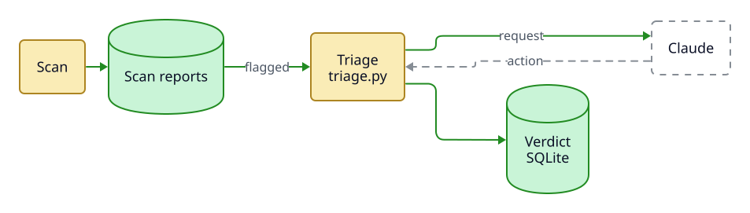

# Review loop design

This page explains how security-runtime turns a dependency scan into a reviewed verdict and which design rules the unattended loop must keep. Order, status, and acceptance criteria for each piece of work are tracked on the [LLM Security Runtime Roadmap](https://github.com/users/kobaltoxid/projects/1) project board, which is private.

## Goal and constraints

The goal is an unattended loop that turns a change to source or a release artifact into a reviewable dependency security report. Ordinary runs should need no human input once the review criteria are configured.

- The runtime, not the model, owns tool permissions, time budgets, and stop conditions.
- The model sees only the current run's evidence. The design uses no retrieval index or model training.
- Public pilot jobs use public source and advisory data. Reports from private inputs stay restricted.
- Any write to a live system needs a runtime check that ties the approver, revision, destination, and exact payload to the recorded action.

## How it works today

A scan produces reports, and the triage worker reviews one finding from those reports with a model. The model only proposes actions; the runtime decides what evidence it sees and records each step.

Figure 1. Scan and triage path. Green: main path; dashed grey: model reply. See the [D2 source](diagrams/scan-and-triage.d2).

1. **Scan.** `runtime.py` runs SecDepth on a local checkout or artifact, and the reusable `scan.yml` workflow runs it on a pull request's head commit. SecDepth calls secpeel for compiled artifacts. The runtime keeps the JSON and HTML reports, scan log, and finding deltas for each stream. [Monitor a target](monitor-a-target.md)
2. **Triage.** `triage.py` selects a finding that SecDepth flagged for review. Each model call has tools disabled and returns one action: inspect checks, inspect components, or finish with a verdict.
3. **Validate.** The runtime returns `insufficient_evidence` when the model proposes an invalid action, repeats an inspection, asks for more than two, or cites evidence it did not inspect. A verdict other than `insufficient_evidence` must cite at least one observation.
4. **Record.** Each step and the final verdict are stored in SQLite, keyed by a digest of the input, model, provider, and policy version. A rerun resumes from the last committed step or returns the stored verdict. [Triage a finding](triage-a-finding.md)

## Planned additions

These describe how the remaining work should behave. The project board holds their order and completion criteria.

- **Acceptance check.** A [floop](https://github.com/kobaltoxid/floop)-based review checks whether the cited evidence supports the verdict. If it fails, the runtime allows one bounded revision before marking the review inconclusive.
- **More triggers in CI.** The local runtime already labels push, merge-request, release, and scheduled runs. The reusable workflow scans only pull requests today; release scans should record the artifact digest and secpeel evidence.
- **Quality baseline.** Compare SecDepth alone, a one-shot review, and the gated loop on the same held-out, human-labeled findings. Use the same model and evidence for both model variants. Report inconclusive cases beside accuracy so the gate cannot look better by withholding difficult verdicts.
- **Gated writes.** A GitHub write, such as a PR comment, waits for an approval that becomes invalid if the destination or body changes.

After the pilot, isolated regression fuzzing of owned code could add test and coverage evidence. Kubernetes Jobs become useful only when scans need a separate worker pool or stronger isolation; until then, a CI runner with persistent state is enough.
